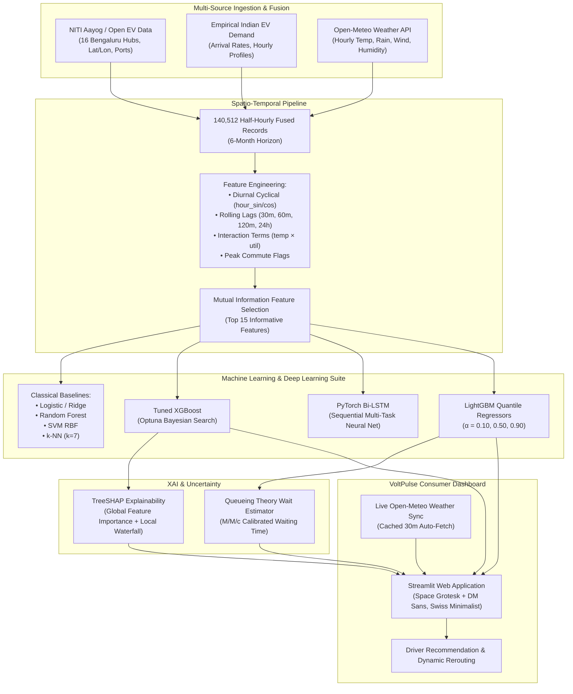

# ⚡ VoltPulse — Bengaluru Smart EV Charging Hub Congestion & Slot Forecasting

[](https://streamlit.io)
[](https://python.org)
[](https://xgboost.readthedocs.io)
[](https://pytorch.org)
[](https://github.com/slundberg/shap)
[](https://opensource.org/licenses/MIT)

> **"Beat the queue. Charge smarter across Bengaluru."**  
> An end-to-end AI/ML spatio-temporal intelligence platform designed to forecast electric vehicle (EV) charging hub utilization, estimate calibrated wait-time confidence intervals, and recommend optimal charging windows with explainable AI across major tech corridors in Bengaluru, India.

---

## 📌 Problem Overview & Motivation

Rapid electric vehicle adoption across Bengaluru's primary tech corridors (Whitefield ITPL, Koramangala, Indiranagar, Electronic City, Hebbal) has created severe peak-hour bottlenecks at fast-charging stations. EV drivers face unpredictable queues lasting 20–45 minutes, leading to range anxiety and charging grid inefficiency.

**VoltPulse** addresses this challenge by fusing multi-source empirical data to:
1. **Forecast Station Congestion State (3-Class)**: Low Queue ($\le 50\%$), Moderate Queue ($50\% - 80\%$), High Congestion ($> 80\%$).
2. **Predict 30-Minute Ahead Continuous Port Utilization**: Regression model with calibrated uncertainty quantification.
3. **Quantile Uncertainty Interval**: 80% confidence bound $[\hat{y}_{10\%}, \hat{y}_{90\%}]$ via LightGBM pinball loss regression.
4. **Actionable Plain-English Explanations**: Local feature contributions via TreeSHAP condensed into short, instant scannable driver badges.
5. **Real-time Live Weather Integration**: Dynamic weather auto-sync via Open-Meteo Current Weather API for ambient temperature and precipitation adjustments.

---

## 🏛️ System Architecture



---

## 📊 Comprehensive Model Benchmark

All models were evaluated using a strict **chronological 80/20 train-test split** (112,409 train / 28,103 test records) with zero future data leakage.

| Model / Architecture | Accuracy | Precision | Recall | Macro F1 | ROC-AUC | RMSE | MAE | $R^2$ | Latency (ms) |
| :--- | :---: | :---: | :---: | :---: | :---: | :---: | :---: | :---: | :---: |
| **Tuned XGBoost (Optuna)** 🏆 | **0.8750** | **0.8356** | 0.7906 | **0.8100** | **0.9679** | **0.1030** | **0.0797** | **0.8213** | **6.93** |
| **XGBoost (Baseline)** | 0.8738 | 0.8339 | 0.7894 | 0.8087 | 0.9682 | 0.1028 | 0.0797 | 0.8220 | 5.27 |
| **PyTorch Bi-LSTM (Multi-Task)** | 0.8712 | 0.8079 | **0.8071** | 0.8075 | 0.9662 | 0.1042 | 0.0808 | 0.8175 | 12.00 |
| **Random Forest** | 0.8727 | 0.8409 | 0.7707 | 0.7984 | 0.9665 | 0.1037 | 0.0802 | 0.8190 | 14.61 |
| **Support Vector Machine (RBF)** | 0.8654 | 0.8237 | 0.7595 | 0.7861 | 0.9559 | 0.1089 | 0.0898 | 0.8004 | 1608.60 |
| **Logistic / Ridge Regression** | 0.8615 | 0.8140 | 0.7522 | 0.7774 | 0.9560 | 0.1100 | 0.0829 | 0.7962 | 0.34 |
| **k-Nearest Neighbors (k=7)** | 0.8376 | 0.7711 | 0.7134 | 0.7368 | 0.9285 | 0.1198 | 0.0932 | 0.7585 | 158.50 |
| **Quantile Regressor (LightGBM)** | 0.8281 | 0.8353 | 0.6831 | 0.7315 | 0.8438 | 0.1101 | 0.0709 | 0.7960 | 0.90 |

*Key Findings:*
- **Tuned XGBoost** achieved the highest overall accuracy (87.50%) and Macro F1 (0.8100) with ultra-fast inference (6.93 ms).
- **PyTorch Bi-LSTM** delivered the highest multi-class recall (80.71%) by capturing sequential diurnal temporal transitions across sliding sequences.
- **LightGBM Quantile Regressors** achieved 83.22% empirical test coverage for the target 80% confidence interval $[\hat{y}_{10\%}, \hat{y}_{90\%}]$.

---

## 🔍 Key Feature Drivers (TreeSHAP XAI)

Feature selection via Mutual Information identified the top 15 predictive drivers:
1. `utilization_rate` (Current Station Port Occupancy)
2. `temp_x_util` (Interaction: Temperature × Utilization)
3. `util_lag_30m` & `util_lag_60m` (Short-term Inflow Momentum)
4. `util_lag_24h` (Same-time Day Prior Seasonality)
5. `hour_sin` & `hour_cos` (Cyclical Diurnal Office Rush Encodings)
6. `is_peak_commute` (Office Commute Peak Windows: 8–10 AM & 6–8:30 PM)
7. `util_roll_mean_3h` & `util_roll_std_3h` (Moving Average Demand & Volatility)
8. `temperature_2m` (Battery Thermal Charging Efficiency)
9. `longitude` & `latitude` (Tech Corridor Spatial Geolocation)

---

## 📂 Project Directory Structure

```plaintext
EV_Congestion_AIML/
├── app.py                     # Streamlit consumer web application
├── requirements.txt           # Project Python dependencies
├── .gitignore                 # Standard git ignore definitions
├── .streamlit/
│   └── config.toml            # Streamlit theme & server configuration
├── data/
│   ├── raw/
│   │   ├── bengaluru_stations.csv  # 16 standardized Bengaluru charging hubs
│   │   ├── bengaluru_weather.csv   # Historical hourly Open-Meteo weather
│   │   └── ev_charging_data.csv    # Empirical Indian EV demand dataset
│   └── processed/
│       └── bengaluru_ev_fused.csv  # 140,512 fused half-hourly records
├── models/
│   ├── xgboost_tuned_clf.joblib    # Optuna-tuned XGBoost Classifier
│   ├── xgboost_tuned_reg.joblib    # Optuna-tuned XGBoost Regressor
│   ├── lgbm_quantile_10.joblib     # LightGBM Quantile Regressor (α = 0.10)
│   ├── lgbm_quantile_50.joblib     # LightGBM Quantile Regressor (α = 0.50)
│   ├── lgbm_quantile_90.joblib     # LightGBM Quantile Regressor (α = 0.90)
│   ├── bilstm_multitask.pth        # PyTorch Bi-LSTM Multi-Task Neural Net
│   ├── random_forest_clf.joblib    # Random Forest Classifier baseline
│   ├── random_forest_reg.joblib    # Random Forest Regressor baseline
│   ├── svm_clf.joblib & svm_reg.joblib  # Support Vector Machine models
│   ├── knn_clf.joblib & knn_reg.joblib  # k-Nearest Neighbors models
│   ├── scaler.joblib               # StandardScaler object
│   └── selected_features.json      # Top 15 Mutual Info selected features
├── results/
│   ├── model_benchmark.csv        # Comprehensive benchmarking metrics
│   ├── eda/                       # High-resolution exploratory analysis charts
│   ├── plots/                     # Confusion matrices, ROC curves, Quantile plots
│   └── xai/                       # Global SHAP summary and local waterfall plots
└── src/
    ├── 00_download_data.py        # Automated multi-source data ingestion
    ├── 01_fuse_and_eda.py         # Spatio-temporal fusion, cleaning & EDA
    └── 02_train_and_explain.py    # Training, hyperparameter tuning & XAI
```

---

## 🚀 Quickstart & Installation

### 1. Clone the Repository
```bash
git clone https://github.com/Spgamer0407/EV_Congestion_AIML.git
cd EV_Congestion_AIML
```

### 2. Set Up Virtual Environment
```bash
python -m venv venv
# On Windows:
.\venv\Scripts\activate
# On Linux/macOS:
source venv/bin/activate
```

### 3. Install Dependencies
```bash
pip install -r requirements.txt
```

### 4. Run the VoltPulse Web Application
```bash
streamlit run app.py
```
Open [http://localhost:8501](http://localhost:8501) in your browser.

---

## 🔄 End-to-End Pipeline Reproduction

If you wish to re-run the entire pipeline from scratch:

```bash
# Step 1: Download raw Indian stations, demand data, and historical weather
python src/00_download_data.py

# Step 2: Perform spatio-temporal fusion, feature engineering, and generate EDA plots
python src/01_fuse_and_eda.py

# Step 3: Train all 5 classical models, Bi-LSTM, tune XGBoost, and generate XAI artifacts
python src/02_train_and_explain.py
```

---

## 📄 License & Attribution

This project is licensed under the [MIT License](LICENSE).  
Developed for EV mobility research and smart urban charging infrastructure planning across Bengaluru.
